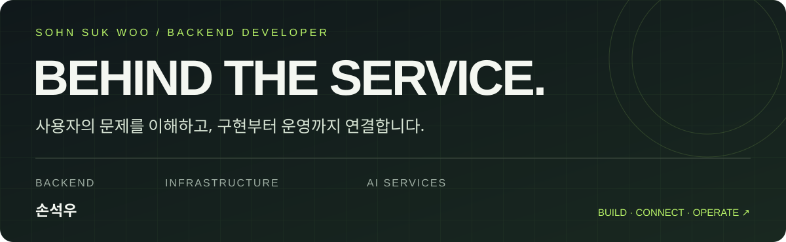
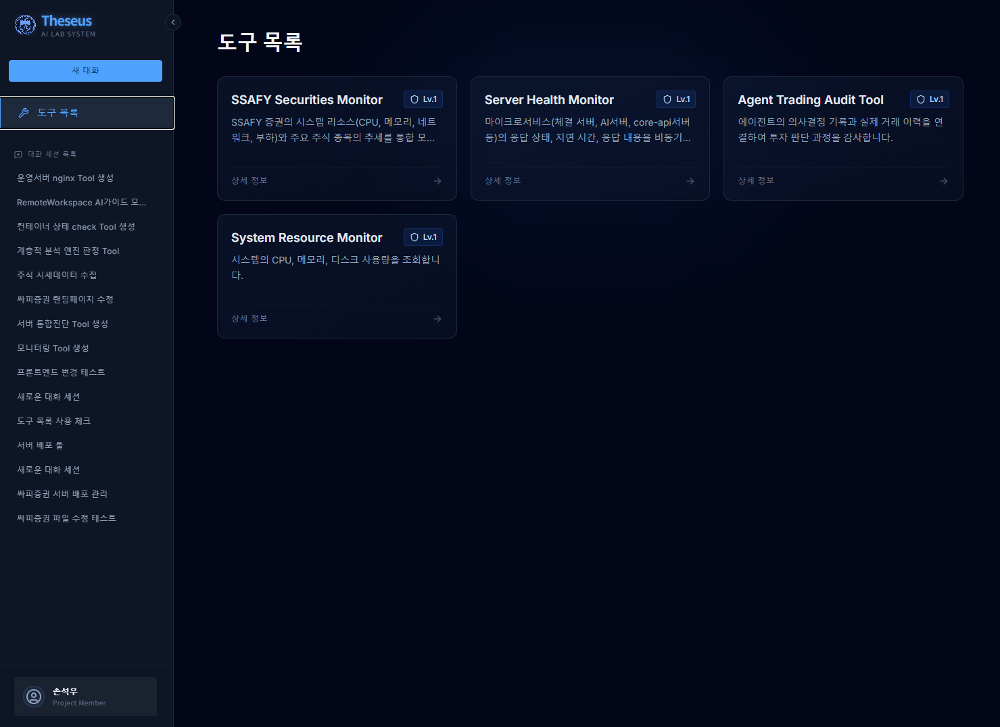
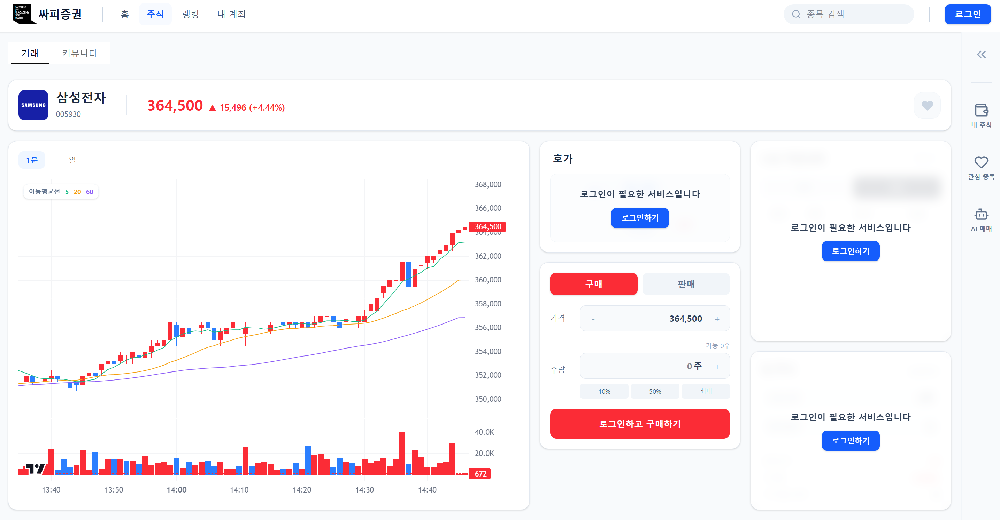
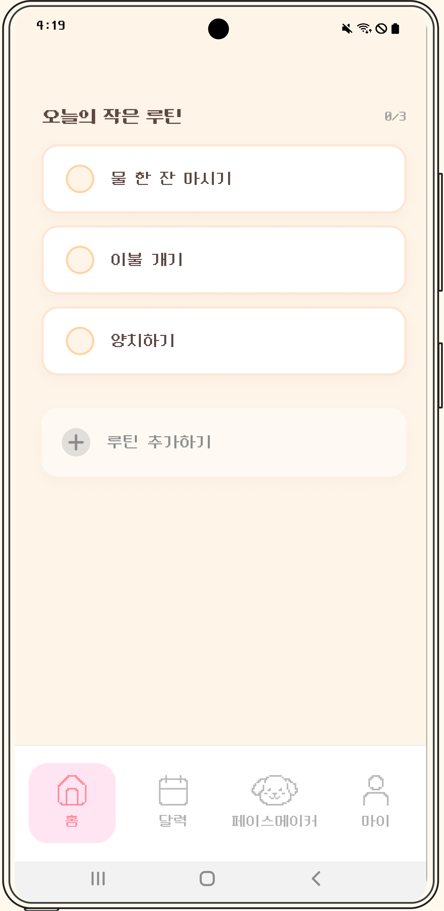
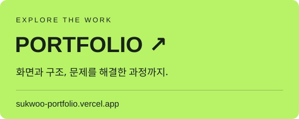

  

  
  

<a href="https://sukwoo-portfolio.vercel.app/">sukwoo-portfolio.vercel.app</a>

## 소개

안녕하세요. **API 개발과 배포·운영을 함께 경험한 백엔드 개발자 손석우입니다.**

대학정보공시 시스템을 운영하며 사용자 요청을 정리하고 데이터 오류를 확인했습니다. 이후에는 요청을 전달하는 데서 나아가 직접 기능을 구현하고 싶어 개발을 시작했습니다. 프로젝트에서는 회원·편지 API를 만들고, 서비스 간 연동과 배포 환경을 구성하며, 실행 중 발생하는 오류를 추적했습니다.

제가 다뤄온 문제는 다음과 같습니다.

- **이미 받은 편지가 다시 오는 문제:** 수신 이력을 확인해 DB 조회 단계에서 매칭 후보를 제외했습니다.
- **AI 작업 중 DB 연결이 고갈되는 문제:** 처리할 데이터가 없는 경로의 트랜잭션 종료 누락을 찾아 rollback과 세션 정리를 보완했습니다.
- **서비스마다 다른 배포 조건:** Docker Compose를 역할별로 나누고 Jenkins에서 변경된 서비스를 골라 배포하도록 구성했습니다.
- **서버는 켜져 있지만 시세가 멈춘 상황:** 수신 로그부터 Redis·Kafka·WebSocket까지 구간을 나눠 확인하고 마켓 서버 재시작 후 화면 갱신을 확인했습니다.

## 경험 한눈에 보기

| 경험 | 내 역할 | 다룬 문제와 작업 | 기술·키워드 |
|---|---|---|---|
| **Theseus** | 팀장 · 인프라 · 백엔드 | AI Core의 DB 연결 고갈 대응, 다중 워커의 Consumer·Scheduler 중복 실행 설정 수정, Remote Workspace 서버 연결 | Spring Boot · FastAPI · Kafka · PostgreSQL · Docker |
| **싸피증권** | 팀장 · 백엔드 · CI/CD | 회원·인증 API, 인증 쿠키·프록시 경로 수정, Compose 레이어 분리와 변경 서비스 선별 배포 | Spring Boot · Jenkins · Docker Compose · Nginx |
| **One-step** | 백엔드 | 회원·펫 성장·편지 API, 수신 이력을 반영한 편지 매칭과 DB 조회 조건 개선 | Java · Spring Boot · JPA · SQL |
| **한국대학교육협의회** | 시스템 운영·유지보수 관련 업무 | 사용자 요청 분류·요구사항 조율, 공시 데이터 검증, 매뉴얼과 교육자료 제작 | 서비스 운영 · 데이터 품질 · 사용자 소통 |

## 02 / Selected work

<table>
<tr>
<td width="50%" valign="top">

<h3>01 · Theseus</h3>
<b>AI Agent 플랫폼</b>

자연어로 AI 도구를 생성하고 원격 서버와 연동해 반복 업무를 자동화하는 서비스.

<b>팀장 · 인프라 · 백엔드</b> Kafka·Redis·SSE 연동, 배포 환경 구성, Remote Workspace EC2 연결

<code>Spring Boot</code> <code>Kafka</code> <code>Docker</code>

</td>
<td width="50%" valign="top">

<h3>02 · SSAFY-Stock</h3>
<b>실시간 모의투자 서비스</b>

실시간 시세와 주문·체결, 투자 커뮤니티를 제공하는 주식 모의투자 서비스.

<b>팀장 · 인프라 · 백엔드</b> Gateway·DB·API 기준 정리, 운영 레이어 분리와 변경 서비스 선별 배포

<code>Spring Boot</code> <code>Redis</code> <code>Jenkins</code>

</td>
</tr>
<tr>
<td width="50%" valign="top">

<h3>03 · One-step</h3>
<b>일상 회복 지원 서비스</b>

고립·은둔 청년의 일상 회복을 돕는 행동 유도 기반 Android 서비스.

<b>백엔드</b> 회원·프로필·펫 성장 API, 편지 전달·랜덤 매칭·금칙어 필터링 구현

<code>Java</code> <code>Spring Boot</code> <code>JPA</code>

</td>
<td width="50%" valign="top">

<h3>프로젝트를 더 자세히</h3>

서비스 화면, 시스템 구조, 담당 업무와 문제 해결 과정을 공개 포트폴리오에서 확인하실 수 있습니다.

AI 모델 연구보다 AI 기능이 실제 서비스에서 동작하도록 서버와 운영 환경을 연결하는 일에 관심이 있습니다.

<a href="https://sukwoo-portfolio.vercel.app/"><b>포트폴리오 방문하기 ↗</b></a>

</td>
</tr>
</table>

## 🚀 Experience

### 🏢 한국대학교육협의회

**대학정보공시 시스템 운영·유지보수 | 2020.12 ~ 2023.06**

- 대학정보공시 통합 시스템 및 대학알리미 운영
- 사용자 요청 접수·분류 및 요구사항 조율
- 공시 데이터 검증 및 품질 점검
- 사용자 매뉴얼·연수자료 제작 및 교육

### 🎓 SSAFY 14기

**Backend · Infrastructure · Team Leadership**

- Python 기반 알고리즘 학습 및 문제 해결
- Spring Boot 기반 API 개발과 데이터베이스 설계
- Kafka · Redis 기반 비동기 처리 및 실시간 서비스 개발
- Docker · Jenkins 기반 CI/CD 환경 구축
- 프로젝트 3회 중 2회 팀장으로 일정 관리와 협업 조율

## 팀 수상

| 프로젝트 | 수상 |
|---|---|
| Theseus | 자율 프로젝트 우수상 — 프로젝트 전시발표회 발표부문 우수상 |
| SSAFY-Stock | 특화 프로젝트 우수상 |
| One-step | 공통 프로젝트 우수상 |

## 🛠 Tech & Tools

#### Backend

<table>
<tr>
<td align="center" width="88"> Java</td>
<td align="center" width="88"> Spring Boot</td>
<td align="center" width="88"> FastAPI</td>
<td align="center" width="88"> PostgreSQL</td>
<td align="center" width="88"> Kafka</td>
<td align="center" width="88"> Redis</td>
<td align="center" width="88"> Swagger</td>
</tr>
</table>

JPA · SQL · SSE · pgvector

#### Infrastructure

<table>
<tr>
<td align="center" width="88"> Docker</td>
<td align="center" width="88"> Jenkins</td>
<td align="center" width="88"> Nginx</td>
<td align="center" width="88"> AWS</td>
<td align="center" width="88"> Linux</td>
</tr>
</table>

EC2 · RDS · Docker Compose

#### Collaboration

<table>
<tr>
<td align="center" width="88"> Git</td>
<td align="center" width="88"> GitHub</td>
<td align="center" width="88"> GitLab</td>
<td align="center" width="88"> Jira</td>
<td align="center" width="88"> Notion</td>
<td align="center" width="88"> Mattermost</td>
</tr>
</table>

#### AI Tools

<table>
<tr>
<td align="center" width="88"> ChatGPT</td>
<td align="center" width="88"> Claude</td>
<td align="center" width="88"> Codex</td>
</tr>
</table>

MCP

## Contact

[Portfolio](https://sukwoo-portfolio.vercel.app/) · [GitHub](https://github.com/sohnsw95) · [sohnsw95@naver.com](mailto:sohnsw95@naver.com)